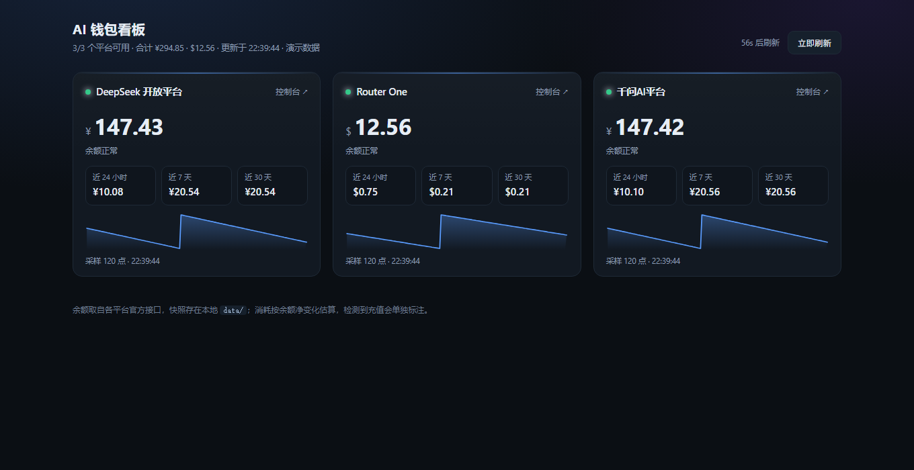

# ai-wallet-dashboard

本地运行的 **AI 平台钱包看板**：把 DeepSeek、Router One 等平台的预付余额收进一个页面，直观看到余额、近 24 小时 / 7 天 / 30 天消耗趋势，余额过低时高亮告警。

零依赖、单命令启动、只监听 `127.0.0.1`，Key 不离开本机。



## 为什么

现在用 AI 的人手里通常不止一个平台的余额：

- DeepSeek 开放平台的充值余额（按 token 扣费）
- Router One 这类网关的 USD 预付余额
- 以后还可能有百炼、TokenHub、OpenRouter……

每查一次余额就要登一次控制台，且各家用「余额」而不是「已用 token」计价，很难判断这个月到底烧了多少。这个工具把「查余额」变成一块常驻桌面、自动刷新的看板。

## 特性

- **一个页面看全部**：多平台卡片并排，按币种自动合计
- **消耗趋势**：近 24h / 7d / 30d 净消耗 + 余额曲线（充值会单独标出）
- **低余额告警**：每个平台可配置告警线，低于阈值卡片变黄
- **零依赖**：只用 Node 内置模块，`git clone` 即可运行
- **本地优先**：快照存 `data/*.jsonl`，不上传任何数据，不做遥测
- **易扩展**：新增平台 = 写一个 20 行的适配器文件

## 快速开始

要求 Node.js ≥ 18.17（推荐 20+）。

```bash
git clone https://github.com/<you>/ai-wallet-dashboard.git
cd ai-wallet-dashboard

# 1. 配置 Key（PowerShell）
$env:DEEPSEEK_API_KEY = "sk-..."
$env:ROUTER_ONE_API_KEY = "sk-..."

# 2. 启动（自动打开浏览器）
npm start
```

打开 <http://127.0.0.1:8787> 即可。没有 Key 也能先看界面：

```bash
npm run demo     # 演示数据，不发起任何网络请求
```

一次性输出（适合写进脚本 / 定时任务）：

```bash
npm run snapshot           # 人类可读
npm run snapshot -- --json # 机器可读
```

### 桌面化（Windows）

浏览器打开后，用 Edge/Chrome 的「安装此站点为应用」或直接建快捷方式：

```powershell
# 无地址栏的独立窗口
msedge --app=http://127.0.0.1:8787
```

配合「启动」文件夹或计划任务，开机即常驻。macOS 可用 `open -a "Google Chrome" --args --app=http://127.0.0.1:8787`。

## 支持的平台

| id | 平台 | 接口 | 币种 | Key 获取 |
| --- | --- | --- | --- | --- |
| `deepseek` | DeepSeek 开放平台 | `GET https://api.deepseek.com/user/balance` | CNY（国内账号） | <https://platform.deepseek.com/api_keys> |
| `routerone` | Router One | `GET https://api.router.one/v1/balance` | USD | <https://router.one/dashboard/api-keys> |
| `qianwen` | 千问AI平台 | 官方 CLI `qianwen billing balance summary --format json` | CNY | CLI 登录（见下） |

> DeepSeek 的余额接口需要 **API Key**（`sk-...`），不是网页登录态。

### 千问AI平台（特殊）

千问没有公开的余额 REST 接口，`sk-ws-…` 这类 API Key 只能调推理，查余额必须走官方 CLI 的**管理登录**：

```bash
npm install -g @qianwenai/qianwen-cli
qianwen auth login                                   # OAuth 设备码，浏览器里点一下
qianwen billing balance summary --format json        # 看板就是调这条
```

看板会直接调用 `qianwen` 命令并解析 JSON；没装或没登录时卡片显示对应提示，不影响其它平台。如果你的 `qianwen` 不在 PATH 里，用配置覆盖：

```json
{ "providers": { "qianwen": { "command": "C:/path/to/qianwen.cmd" } } }
```

它还能查用量，适合后续扩展成"token 消耗"卡片：`qianwen usage summary`、`qianwen usage payg`、`qianwen usage free-tier`。

## 配置

可选配置文件 `ai-wallet.config.json`（或 `--config` 指定）：

```json
{
  "refreshSeconds": 60,
  "dataDir": "./data",
  "providers": {
    "deepseek": { "lowBalance": 20, "currency": "CNY" },
    "routerone": { "lowBalance": 2 }
  }
}
```

| 字段 | 说明 |
| --- | --- |
| `refreshSeconds` | 前端轮询与服务端缓存时长，默认 60 |
| `dataDir` | 快照目录，默认 `./data` |
| `providers.<id>.lowBalance` | 低余额告警线（平台默认值见适配器） |
| `providers.<id>.name` | 覆盖显示名（多账号时有用） |

环境变量优先于配置文件：`DEEPSEEK_API_KEY`、`ROUTER_ONE_API_KEY`、`AI_WALLET_DATA_DIR`、`AI_WALLET_CONFIG`。

平台级可选字段：`name`（显示名）、`lowBalance`（告警线）、`command` / `args` / `timeoutMs`（仅 `qianwen` 这类壳调用型平台）。

## 工作原理

各平台普遍只提供「当前余额」，不提供「这段用了多少 token」。因此本项目用**余额快照**推导消耗：

1. 每次刷新向各平台查一次余额，追加一行到 `data/<平台>.jsonl`
2. 同一窗口内 `首个点 - 最后一个点` = 净消耗 − 充值
3. 净值为正 → 记为消耗；净值为负 → 记为充值（充值和消耗同时发生时会互相抵消，所以 UI 文案用「净消耗」）

好处：任何能查余额的平台都能接入，不需要各家的用量 API。代价：采样点不足 2 个时显示「数据不足」；平台在两次采样之间既充值又消耗时，数字会被抹平。

## 新增一个平台

在 `src/providers/` 下新建文件，导出同样结构即可：

```js
// src/providers/example.mjs
import { fetchJson, toNumber, round } from '../util.mjs'

export default {
  id: 'example',
  name: '示例平台',
  envKeys: ['EXAMPLE_API_KEY'],
  dashboardUrl: 'https://example.com/billing',
  defaultLowBalance: 5,

  async fetchSnapshot({ env }) {
    const key = env.EXAMPLE_API_KEY
    if (!key) throw new Error('未配置 EXAMPLE_API_KEY')
    const data = await fetchJson('https://api.example.com/v1/balance', {
      headers: { authorization: `Bearer ${key}` },
    })
    return {
      currency: 'CNY',
      balance: round(toNumber(data.balance)),
      total: round(toNumber(data.balance)), // 趋势用 total 比较，建议含赠送/冻结
      reserved: 0,
    }
  },
}
```

然后在 `src/providers/index.mjs` 的 `PROVIDERS` 数组里加一行，补一个测试（见 `test/store.test.mjs` 的 fake 平台写法）。

## 常见问题

- **401 / invalid token**：Key 填错或已删除；DeepSeek 需要 `api_keys` 页面创建的 Key，不是账号密码。
- **卡片显示「未连接」**：对应环境变量没设置。Windows 里新开终端后 `$env:` 不会自动继承。
- **消耗一直是「数据不足」**：刚启动，至少需要两次采样（默认 1 分钟后）。
- **余额比预期低**：DeepSeek 优先扣赠送余额，Router One 的 `balance` 已含赠送额度，且进行中的请求会临时占用 `reserved_balance`。
- **能查用量（token 数）吗**：本项目只做余额维度；接入各家用量 API 在路线图里。

## 路线图

- [ ] 千问 `usage payg` 接入，展示 token 级消耗而非余额差值
- [ ] 阿里云百炼（OpenAPI 签名）与腾讯云 TokenHub（TC3 签名）
- [ ] OpenAI / Anthropic / OpenRouter 等海外平台
- [ ] 按 token 计费的用量接口接入（有则优先于余额推导）
- [ ] 历史数据导出 CSV、月度账单视图
- [ ] 桌面挂件（Electron / Tauri，可置顶）
- [ ] DSH 插件形态，直接在 Harness 侧边栏显示

## 贡献

见 [CONTRIBUTING.md](./CONTRIBUTING.md)。Issues / PR 都欢迎，新增平台适配器的 PR 最好附上接口文档链接。

## License

[MIT](./LICENSE)
